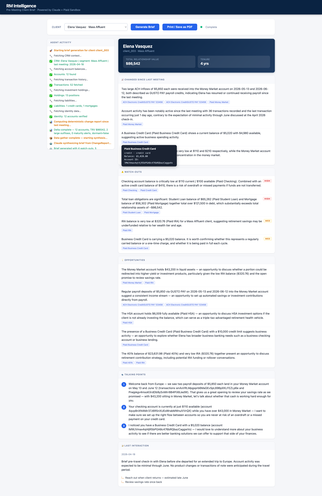

# RM Pre-Meeting Intelligence Brief

> 🎥 **Demo recording:** [youtube.com/watch?v=jKShU4F57ng](https://www.youtube.com/watch?v=jKShU4F57ng)

An **agentic AI service for bank Relationship Managers**, grounded in **Plaid Sandbox** data plus
a synthetic PostgreSQL CRM:

- **Pre-meeting brief** — a one-page, fully-cited brief generated from a single client ID.
- **Brief chat** — ask questions about the brief and propose edits; the RM approves each change,
  which is saved as a new brief version.
- **Post-meeting capture** — typed notes, photos of handwritten notes, voice memos or (with
  consent) meeting recordings, turned into a reviewed CRM entry with tracked promises.

Everything runs locally via Docker Compose; the only external calls are to Plaid Sandbox and the
Anthropic API (directly, or through a corporate AI gateway).

> **Focus areas:** Primary — *Deliver High-Value Use Cases* (Embedded Banking / Finance).
> Secondary — *Advance Agent-Based AI Capabilities* · *Operationalize GenAI (LLMOps & Quality)*.
>
> Full write-up: [`docs/problem-and-solution.md`](docs/problem-and-solution.md) ·
> architecture diagrams: [`docs/architecture.md`](docs/architecture.md) ·
> limitations & next steps: [`docs/limitations-and-next-steps.md`](docs/limitations-and-next-steps.md) ·
> cost-benefit: [`cba/cost-benefit-analysis.md`](cba/cost-benefit-analysis.md) ·
> models: [`docs/model-usage.md`](docs/model-usage.md) ·
> prompts: [`prompts/`](prompts/).



## The problem

Before each of 6–8 daily client meetings, a Relationship Manager stitches together the client's
picture by hand: core-banking screens, CRM notes from the last meeting, recent transactions,
holdings, and whatever they promised last time. It's slow, inconsistent and easy to get wrong — a
missed CD maturity or an unexplained large outflow is a missed conversation. After the meeting,
notes and promises have to be typed into the CRM, and commitments get dropped. Simply asking an
LLM to "summarize the client" isn't acceptable in a bank: invented numbers, no audit trail, and
cost at scale. Full statement: [`docs/problem-and-solution.md`](docs/problem-and-solution.md).

## The design that makes it bank-grade

We split **"what is true" (deterministic) from "how to say it" (the LLM)** — the model is never
trusted with arithmetic, dates, or comparisons.

```
GET /briefs/{clientId}/stream  (Server-Sent Events)
  └── AgentOrchestrator.run()
        ├── 1. GATHER     6 read-only tools → Plaid Sandbox + synthetic CRM (Postgres)
        ├── 2. DELTA      DeltaService — pure Java, ZERO LLM tokens → ChangeReport
        ├── 3. SYNTHESIZE one Claude call, prose strictly from the ChangeReport
        ├── 4. VALIDATE   strip any citation ID not present in the ChangeReport
        ├── 5. SAVE       brief stored as version 1 (chat edits create later versions)
        └── 6. STREAM     SSE events for each phase so the agent is observable
```

This gives three guarantees a bank needs: **no invented numbers**, **auditable citations**, and
**one right-sized model call per brief** (cost control). The same rule carries into chat (totals
and comparisons come from Java tools) and capture (dates and products are resolved in Java, and
nothing reaches the CRM without the RM's approval). Flow diagrams for all three features:
[`docs/architecture.md`](docs/architecture.md).

## Models and rationale

| Feature | Exact model ID (default) | Setting | Calls |
|---|---|---|---|
| Pre-meeting brief synthesis | `claude-sonnet-5` | `BRIEF_MODEL` | 1 per brief |
| Brief chat | `claude-sonnet-5` | `CHAT_MODEL` | 1–3 rounds per question |
| Capture: photo transcription, speaker labels, extraction | `claude-sonnet-5` | `CAPTURE_MODEL` | 1 extraction + 1 per photo + 1 per recording |
| Gather planning (agentic mode only) | `claude-sonnet-5` | `AGENT_MODEL` | Short tool loop |
| Speech-to-text | Whisper `base.en` (self-hosted) | `TRANSCRIPTION_PROVIDER` | Not a Claude call |

**Why Sonnet 5:** it's strong enough for grounded financial prose, structured extraction and tool
use at a fraction of frontier-model cost ($2 / $10 per 1M input/output tokens; ~4¢ per brief,
measured). Correctness doesn't depend on model size — numbers, dates and citation checks are
Java — so each feature can move to a cheaper or stronger model by changing one setting. Speech-to-
text runs self-hosted so client audio stays on the bank's network. Details:
[`docs/model-usage.md`](docs/model-usage.md); exact prompts: [`prompts/`](prompts/).

## Quick start

**Prerequisites:** Docker Desktop with **~8 GB memory** and **~7 GB free disk** (the Whisper
speech-to-text image is ~5 GB). A local non-Docker build needs JDK 21+.

```bash
# 1. Configure secrets
cp .env.example .env
#    then edit .env and fill in:
#      ANTHROPIC_API_KEY=sk-ant-...
#      PLAID_CLIENT_ID=...
#      PLAID_SECRET=...
#      PLAID_ENV=sandbox
#      MEDIA_ENCRYPTION_KEY=<output of: openssl rand -base64 32>   # encrypts captured photos/audio

# 2. Build and start everything: brief-api, Postgres, Redis, Temporal, Whisper
docker compose up -d --build     # first run: several minutes (image pulls + Whisper model download)

# 3. Health check
curl http://localhost:8080/health      # {"status":"UP"}

# 4. Link each demo client to a Plaid Sandbox item (once per fresh database, or when items expire)
curl -X POST http://localhost:8080/admin/seed-client -H "Content-Type: application/json" -d '{"clientId":"client_001","persona":"user_good","plantLargeOutflow":false,"force":true}'
curl -X POST http://localhost:8080/admin/seed-client -H "Content-Type: application/json" -d '{"clientId":"client_002","persona":"user_good","plantLargeOutflow":false,"force":true}'
curl -X POST http://localhost:8080/admin/seed-client -H "Content-Type: application/json" -d '{"clientId":"client_003","persona":"user_good","plantLargeOutflow":false,"force":true}'
curl -X POST http://localhost:8080/admin/seed-client -H "Content-Type: application/json" -d '{"clientId":"client_004","persona":"user_good","plantLargeOutflow":false,"force":true}'
```

Each seed call should return `"message":"OK"`.

| Open | URL |
|---|---|
| Pre-meeting brief + chat | http://localhost:8080 |
| Meeting capture + review | http://localhost:8080/capture.html |
| Temporal workflows (capture) | http://localhost:8233 |

## Using it

**Brief.** Pick a client and click **Generate Brief**. Gather and delta steps stream immediately;
the synthesized brief arrives in about 30–40 seconds (the model thinks before writing). Every
chip is a clickable citation. Briefs are saved: the page reopens a client's latest brief, the
**Saved briefs** dropdown lists older ones, and the URL (`/?client=…&brief=…`) links straight to
one. **Print / Save as PDF** prints just the brief.

**Chat.** Click **💬 Ask about this brief**. Ask questions ("how much went to United Airlines, by
month?") or for changes ("add a watch-out about…"). Answers stream in with clickable sources;
every total and comparison is computed by a Java tool. Suggested changes appear as cards with
before/after — **Apply** saves a new brief version (switch versions in the bar above the brief;
older ones open read-only). Chat is not stored — leaving or refreshing the page clears it.
Claude declines investment advice and won't draft client emails.

**Capture.** On the capture page, add any mix of typed notes, photos of handwritten notes, a voice
memo (record in the browser or upload a file), or a meeting recording. Click **Process capture**
and watch the steps; then review the draft — every item shows the source line it came from, and
flagged items need **Keep** or **Drop**. **Approve & save to CRM** writes the interaction and
tracked promises, which the next brief picks up. Meeting recording is off until the
**Compliance setting** is switched on, and needs the client's consent before the recorder unlocks.

### Replay the demo (~5 minutes)

1. **Reset the hero client** (fresh Plaid data):
   ```bash
   curl -X POST http://localhost:8080/admin/seed-client \
     -H "Content-Type: application/json" \
     -d '{"clientId":"client_002","persona":"user_good","plantLargeOutflow":false,"force":true}'
   ```
2. **Brief** — open http://localhost:8080, pick **Robert Harrington**, click **Generate Brief**.
   Watch the agent steps stream; click a citation chip to see the underlying record. Facts like
   the matured $150,000 CD come from the deterministic ChangeReport — inspect it at
   http://localhost:8080/debug/delta/client_002.
3. **Chat** — click **💬 Ask about this brief**, ask *"How much went to United Airlines, by
   month?"* (totals computed by a Java tool), then *"Add a watch-out about …"* and click **Apply** —
   the version bar shows v2, and v1 is still viewable.
4. **Capture** — open http://localhost:8080/capture.html, pick the same client, paste notes such
   as *"Client asked about HELOC rates. I will send CD renewal options by next Friday."*, click
   **Process capture**. Review the draft (note "next Friday" resolved to a date and flagged as
   ambiguous), Keep/Drop flagged items, **Approve & save to CRM**.
5. **Close the loop** — click **Generate … brief →**: the new meeting and the tracked promise (with
   its due date) now appear in the brief. The capture's workflow is visible at
   http://localhost:8233.

Each run creates new captures, promises and brief versions; re-seeding Plaid doesn't remove them.
For a completely fresh start, `docker compose down -v` (deletes all data) and redo the Quick start.

## Demo clients (synthetic)

| ID | Name | Segment | Scenario |
|---|---|---|---|
| `client_001` | Margaret Chen | Private | Clean / baseline; term deposit maturing |
| `client_002` | **Robert Harrington** | Mass Affluent | **Hero** — matured CD, large recurring outflow |
| `client_003` | Elena Vasquez | Mass Affluent | Dormant (last meeting before extended travel) |
| `client_004` | David Okafor | Private | Retirement planning — CD maturing 2026-11-30 |

Clients, meetings and products are seeded by Flyway migrations (`V2__seed.sql`,
`V5__seed_client_004.sql`), so every fresh database has them.

### Adding a client

Use a heredoc so quotes need no escaping (`ON_ERROR_STOP` + a transaction means nothing is
half-created if a line fails):

```bash
docker compose exec -T postgres psql -U rm -d rmbrief -v ON_ERROR_STOP=1 <<'SQL'
BEGIN;
INSERT INTO client (client_id, full_name, segment, relationship_start, rm_name)
VALUES ('client_005', 'New Client', 'Private', '2021-01-01', 'Sarah Williams');
INSERT INTO interaction (client_id, meeting_date, notes, promises)
VALUES ('client_005', '2026-09-01', 'Meeting notes here.', '["A promise"]');
COMMIT;
SQL
```

Then run the seed call for `client_005` (step 4 above). Rows added this way live only in that
database; to make a client part of the standard demo data, add a Flyway migration instead.

## Configuration

Settings live in
[`brief-api/src/main/resources/application.yml`](brief-api/src/main/resources/application.yml);
most can be overridden from `.env`.

| What | Setting (`.env`) | Default |
|---|---|---|
| Brief synthesis model | `BRIEF_MODEL` | `claude-sonnet-5` |
| Brief chat model | `CHAT_MODEL` | `claude-sonnet-5` |
| Capture model (photos, speaker labels, extraction) | `CAPTURE_MODEL` | `claude-sonnet-5` |
| Gather planning model (agentic mode only) | `AGENT_MODEL` | `claude-sonnet-5` |
| Speech-to-text | `TRANSCRIPTION_PROVIDER` (`local-whisper` / `openai` + `OPENAI_API_KEY`) | `local-whisper` |
| Capture review reminder | `CAPTURE_REVIEW_REMINDER` | `48h` |
| Raw photo / voice memo retention | `CAPTURE_RETENTION_NOTES` | `30d` |
| Raw meeting-recording retention | `CAPTURE_RETENTION_RECORDING` | `7d` |

Durations use Spring format (`45s`, `5m`, `48h`, `7d`) — shorten them for demos. Delta thresholds
and the agent mode are in `application.yml`:

```yaml
app:
  delta:
    large-outflow-threshold: 5000   # flag outflows >= this
    dormancy-days: 90
  agent:
    eager-tool-calls: true          # false = Claude plans/sequences the tool calls (agentic mode)
```

After changing `.env`, recreate the container (a plain restart doesn't re-read it):
`docker compose up -d brief-api`.

### Corporate AI gateway

If Claude calls must go through a company gateway with the key in a custom header, add to `.env`:

```
SPRING_PROFILES_ACTIVE=gateway
ANTHROPIC_GATEWAY_URL=https://your-gateway/anthropic
ANTHROPIC_GATEWAY_API_KEY=...
ANTHROPIC_GATEWAY_KEY_HEADER=X-Your-Header
```

The `gateway` profile (bottom of `application.yml`) sends the key **only** in that header, never
as `x-api-key`. Check what's active with `docker compose logs brief-api | grep "\[anthropic\]"`.
Note: capture calls send an `anthropic-beta` header and a `fallbacks` field; some gateways strip
unknown beta features.

## Day-to-day commands

```bash
docker compose build brief-api && docker compose up -d brief-api   # after code or HTML changes
docker compose logs -f brief-api                                    # app logs
docker compose logs brief-api | grep "\[llm\]"                      # model + token usage per Claude call
docker compose stop                                                 # stop, keep all data
docker compose start                                                # start again
```

`docker compose down` keeps data volumes. **Avoid `docker compose down -v`** unless you want a
fresh start: it deletes the database, captures, Temporal history and media, and you'll need to
re-run the seed calls.

## Troubleshooting

| Symptom | Cause / fix |
|---|---|
| Compose says `Set MEDIA_ENCRYPTION_KEY` | Add it to `.env` (`openssl rand -base64 32`). Don't change it later — stored media becomes unreadable. |
| `invalid x-api-key` / 401 | Wrong key, or the gateway profile isn't active. Check the `[anthropic]` log line; recreate the container after editing `.env`. |
| Red ✗ on Plaid tools; "No Plaid access token" or `ITEM_LOGIN_REQUIRED` | Run the seed calls (step 4). Sandbox items expire over time. |
| `UnknownHostException: temporal` in logs | The Temporal container isn't running — `docker compose ps -a` / `docker compose logs temporal`. On corporate networks the Docker Hub pull may be blocked. |
| Capture stuck or failing at "Transcribing" | Whisper is still loading its model on first start — `docker compose logs whisper`. |
| Seed call returns 400 | Send all fields: `persona`, `plantLargeOutflow`, `force`. |

## Endpoints

| Method | Path | Purpose |
|---|---|---|
| GET | `/clients` | List clients for the UI dropdown |
| POST | `/admin/seed-client` | Bootstrap a client's Plaid item (`force:true` to re-seed) |
| GET | `/briefs/{clientId}/stream` | **SSE stream** — runs the full brief pipeline; ends with `brief_saved` |
| POST | `/briefs/{clientId}` | Returns the stream URL (202) |
| GET | `/briefs/saved?clientId=` | A client's saved briefs (newest first) |
| GET | `/briefs/saved/{briefId}?version=` | A saved brief version + ChangeReport + citations + version history |
| POST | `/briefs/saved/{briefId}/chat` | Chat turn — SSE over POST (`step`, `delta`, `proposal`, `answer`) |
| POST | `/briefs/saved/{briefId}/edits` | Apply an approved proposal → new version (409 if the brief changed) |
| GET | `/debug/tools/{clientId}/{tool}` | Run a single read tool, inspect raw output |
| GET | `/debug/delta/{clientId}` | Run the deterministic delta, inspect the ChangeReport |
| GET | `/health` | Liveness check |
| POST | `/captures` | Upload post-meeting notes / photos / audio — starts a capture workflow |
| GET | `/captures` · `/captures/{id}` · `/captures/{id}/stream` | List · full draft for review · SSE progress |
| PUT | `/captures/{id}/items/{itemId}` | Edit a drafted item or Keep/Drop it |
| POST | `/captures/{id}/approve` · `/reject` · `/withdraw-consent` | RM decision (Temporal signal) |
| GET | `/captures/{id}/media/{mediaId}` | Decrypted photo/audio for review (410 after retention) |
| GET/PUT | `/policy/recording` · `/admin/recording-policy` | Compliance toggle for meeting recording |
| GET | `/clients/{id}/promises` | Open promises tracked from approved captures |
| POST | `/promises/{id}/status` | Mark a promise `DONE` or `CANCELLED` |

## Stack

| Layer | Technology |
|---|---|
| API | Java 21 / Spring Boot 4.0 / Maven |
| Database | PostgreSQL 16 (schema + seed via Flyway) |
| Cache | Redis 7 (wired, off by default) |
| Runtime LLM | Claude via `anthropic-java` 2.40.1; models set per feature in `application.yml` |
| Orchestration | Temporal (`temporal-sdk` 1.40.0; dev server in compose) |
| Speech-to-text | Self-hosted Whisper container (switchable to OpenAI via config) |
| Financial data | Plaid Sandbox via `plaid-java` 35.0.0 |
| UI | Two static HTML/JS pages (`index.html`, `capture.html`), no build step |
| Packaging | Multi-stage Docker + Docker Compose |

## Hard constraints (enforced in code)

- **Read-only Plaid** — no write/transfer/payment scopes or endpoints.
- **Deterministic numbers** — `DeltaService` computes the `ChangeReport`; chat totals come from
  Java tools; capture dates and products are resolved in Java. The LLM never does math.
- **Citation validation** — the brief, chat answers and capture drafts all drop citations that
  don't resolve to a real record.
- **Human approval** — nothing reaches the CRM, and no brief changes, without the RM's approval.
- **Recording requires policy + consent** — off by default; consent withdrawal purges the
  recording and everything derived from it.
- **No content in logs** — logs and the audit trail record IDs, actions and token counts only.

## Third-party components (cited per originality rules)

- [Spring Boot 4.0](https://spring.io/projects/spring-boot) (Apache-2.0)
- [`plaid-java`](https://github.com/plaid/plaid-java) 35.0.0 (MIT) — Plaid Sandbox client
- [`anthropic-java`](https://github.com/anthropics/anthropic-sdk-java) 2.40.1 (MIT) — Anthropic Messages API client
- [Flyway](https://flywaydb.org/) · PostgreSQL 16 · Redis 7
- [Temporal](https://temporal.io/) Java SDK (MIT) and `temporalio/temporal` dev server
- [openai-whisper-asr-webservice](https://github.com/ahmetoner/whisper-asr-webservice) (MIT) running OpenAI Whisper models
- Claude models (configurable; default `claude-sonnet-5`) via the Anthropic API

**Data:** all data is synthetic / Plaid Sandbox. No customer PII, account data, or confidential
business data is used, committed, or sent to any external service.

**AI assistance disclosure:** this repository — code, this README, the documents under `docs/`,
the prompt mirrors under `prompts/`, and the cost-benefit analysis under `cba/` — was produced with
**Claude Code**. See [`docs/model-usage.md`](docs/model-usage.md) for the planning-vs-execution
model breakdown.

## Repository layout

```
├── README.md                  # this file
├── CLAUDE.md                  # guidance for AI coding assistants working on this repo
├── brief-api/                 # all application code (src/main/java), static UI, Flyway migrations
├── docs/                      # problem & solution, architecture diagrams, limitations & next steps,
│                              #   model usage, slides, screenshots
├── cba/                       # cost-benefit analysis
├── prompts/                   # exact runtime prompts, tool schemas, model config
├── docker-compose.yml
├── .env.example               # every supported setting, with comments
└── rm-brief-spec.md           # original build spec
```

There are no unit tests — correctness is verified by running the app and hitting the endpoints
above (the `/debug/*` endpoints expose each stage in isolation).
