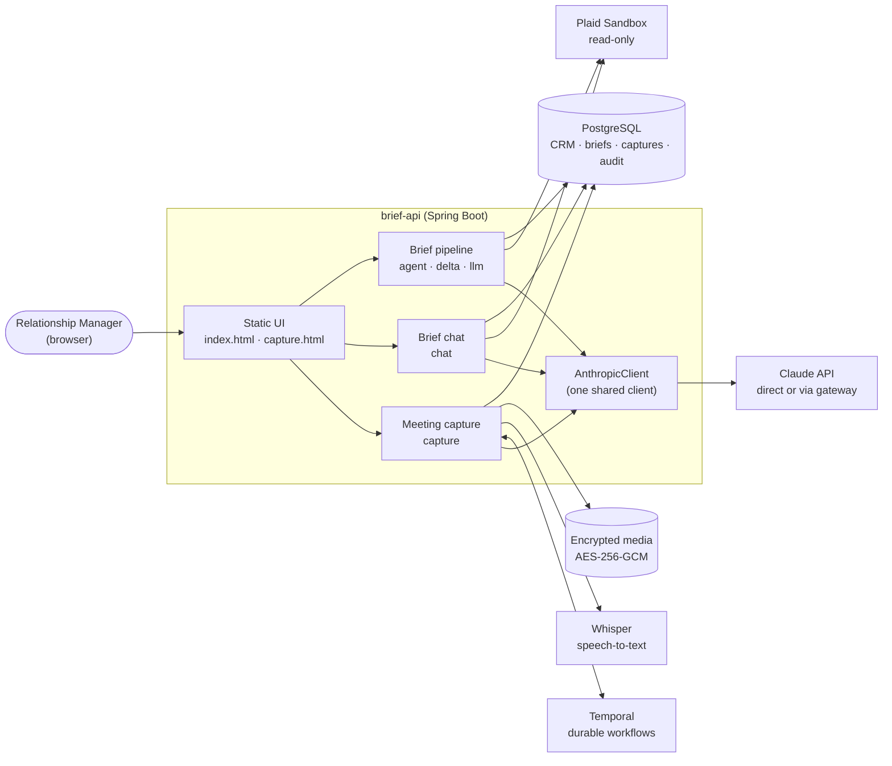
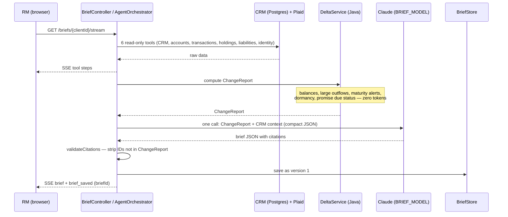
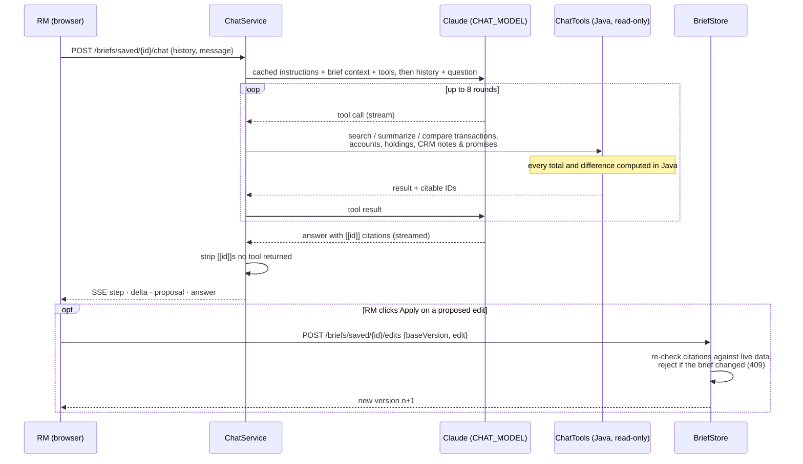
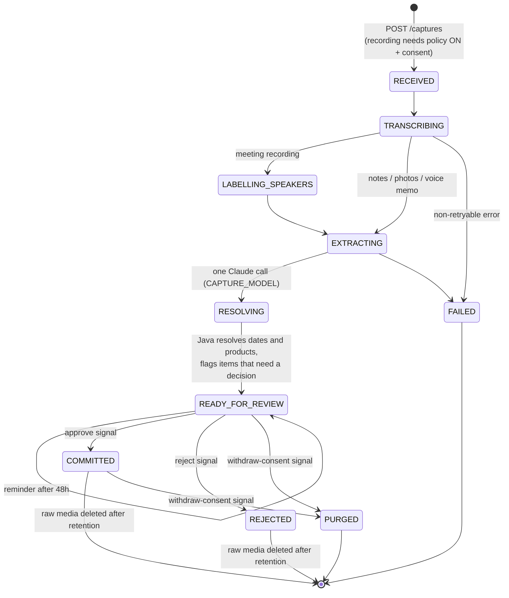

# Architecture

Four diagrams: the system as a whole, then the three flows (pre-meeting brief, brief chat,
post-meeting capture). Code lives in [`brief-api/`](../brief-api/); package names below are under
`com.demo.rmbrief`.

The rule throughout: **Java decides what is true, Claude decides how to say it.** Numbers, dates,
comparisons and citation checks are code; the model writes prose, extracts structure and picks
tools.

## 1. System overview

Redis is wired but off by default. All containers run from `docker-compose.yml`.

## 2. Pre-meeting brief

One HTTP request, streamed as Server-Sent Events.

## 3. Brief chat

Stateless on the server: the browser sends the text history with each question; nothing is stored.

## 4. Post-meeting capture

One Temporal workflow per capture. Only the capture ID crosses into Temporal; notes, transcripts
and media stay in Postgres and the encrypted media store.

What each step does:

| Step | Who | What |
|---|---|---|
| Transcribing | Whisper / Claude vision | Typed notes split into lines; audio transcribed with timestamps; photos read line by line |
| Labelling speakers | Claude | Recordings only: each line labelled RM or client, marked as inferred |
| Extracting | Claude (structured output) | Summary, promises, life events, product interest, concerns, next meeting — each citing source lines; dates and products copied verbatim |
| Resolving | Java | "next Friday" → a date relative to the meeting; "the CD" → the client's actual product; flags (block approval) vs notes (informational) |
| Review | RM | Edit, Keep/Drop flagged items, approve — nothing reaches the CRM otherwise |
| Commit | Java | Writes the CRM interaction and tracked promises; the next brief shows them as due/overdue |
| Retention | Temporal timer | Deletes raw photos/audio after 30 days (7 for recordings) |
